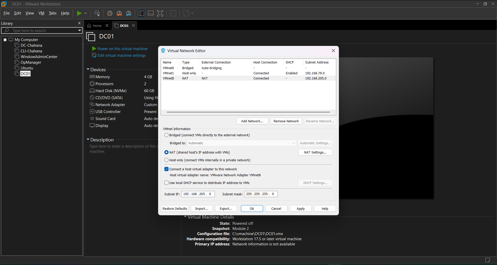
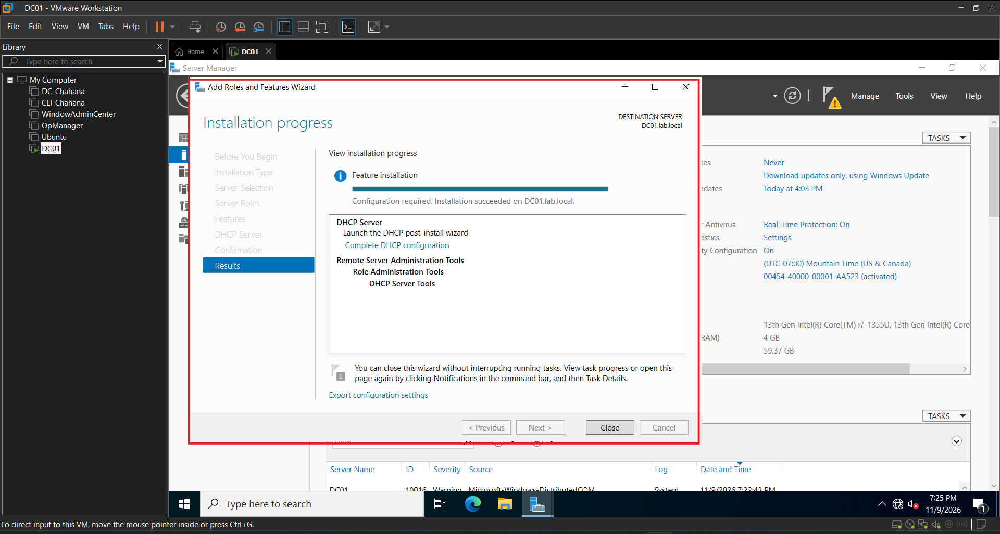
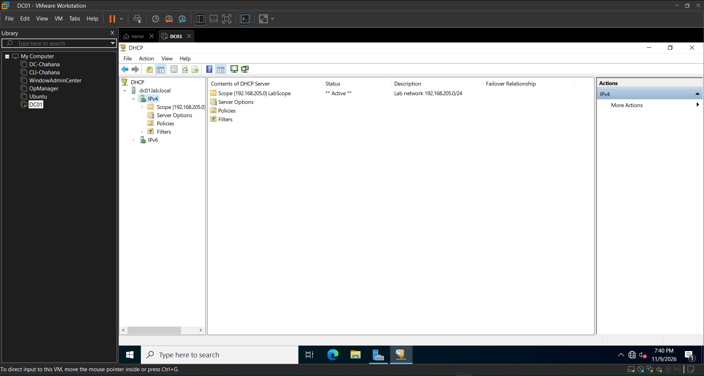
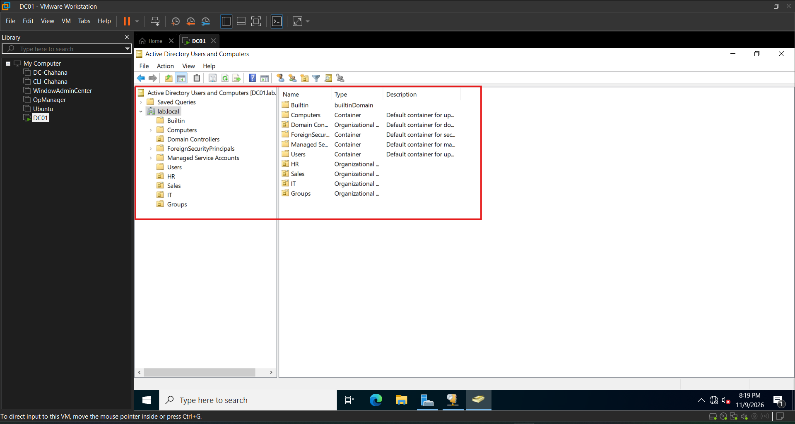
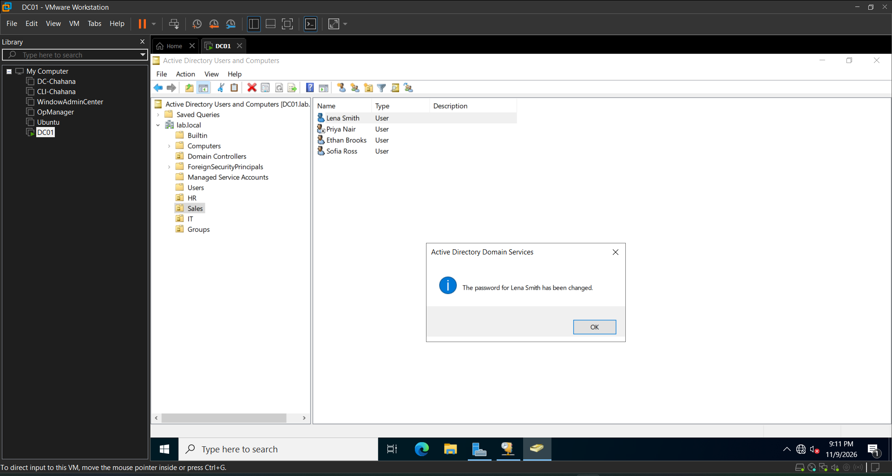
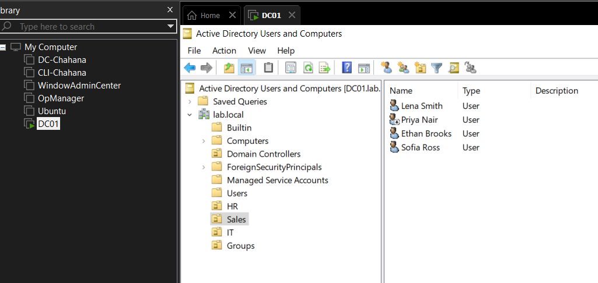

# Help Desk Home Lab: Setup Walkthrough

A virtual IT environment built in VMware Workstation to practice help desk work.

## Lab Environment
| Item | Value |
|---|---|
| Hypervisor | VMware Workstation |
| Server | DC01, Windows Server 2022 Standard (Desktop Experience) |
| Domain | lab.local (NetBIOS: LAB) |
| Server IP | 192.168.205.10 (static) |

## Module 0: Create the Server VM
**What I did:** Created a virtual machine using Custom setup, chose "I will install the operating system later," and attached the Windows Server 2022 ISO manually.

**Why:** Easy Install can fail when the ISO and the guest OS settings don't match. Custom setup gives full control.

**Settings:** 2 cores, 4 GB RAM, 60 GB disk, NAT network, BIOS firmware.

**Result:** The installer listed Windows Server 2022 editions, which confirmed the ISO was genuine. I installed Standard (Desktop Experience), then VMware Tools.

## Module 1: Server Preparation
**What I did:** Set the time zone to Mountain Time, renamed the server to DC01, and assigned a static IP address.

**Why:** A domain controller needs a fixed name and IP address. Changing them after installing Active Directory causes problems.

**Settings:** IP 192.168.205.10, mask 255.255.255.0, gateway 192.168.205.2, DNS 192.168.205.10 (itself) and 8.8.8.8.

**Result:** Ping tests to the server and to 8.8.8.8 succeeded with 0% loss. I took a snapshot as a restore point.

## Module 2: Active Directory
**What I did:** Installed the Active Directory Domain Services role and promoted DC01 to the first domain controller of a new forest, lab.local.

**Why:** Active Directory stores the users, computers, and permissions that a help desk manages every day.

**Settings:** Forest and domain functional level Windows Server 2016, with DNS server and Global Catalog enabled.

**Result:** I signed in as LAB\Administrator, and Active Directory Users and Computers shows lab.local with DC01 under Domain Controllers.

**Note:** The DNS delegation warning during promotion is expected for the first domain controller in a new forest. The DNS forwarder 8.8.8.8 was added automatically, so DC01 answers lab.local itself and forwards internet lookups to Google DNS.

## Module 3: DHCP

**What I did:** I set up DC01 to hand out IP addresses to the computers on my lab network, so I don't have to type addresses in by hand on every machine.

**First, a small thing I had to do:** VMware has its own built-in DHCP service, and two DHCP servers on one network can fight each other. So I turned VMware's off for the VMnet8 network, which made DC01 the only one.

**Setup:** I installed the DHCP Server role, then finished the setup and authorized it in Active Directory (a step called "Commit"). Without that step, the server won't hand out addresses. Then I made a scope called LabScope:
- Address range: 192.168.205.100 to 192.168.205.200
- Gateway (router): 192.168.205.2
- DNS server: 192.168.205.10 (DC01)
- Domain name: lab.local

I kept DC01's own address (192.168.205.10) outside the range on purpose, so a client can never be given the server's address by mistake.

**What I learned:** DHCP gives a computer its address, gateway and DNS all at once. A lot of "I can't connect" problems come from DHCP not working.

## Module 4: Users, Groups and Departments

**What I did:** I built a small fake company inside Active Directory. It has four OUs (think of them as folders): HR, Sales, IT and Groups. I made 9 users and spread them across the departments:
- HR: Noah Gold, Omar Silva
- Sales: Lena Smith, Priya Nair, Ethan Brooks, Sofia Ross
- IT: Hana Sato, Zara Ali, Marcus Rie

Then I created three security groups: HR-Staff, Sales-Staff and IT-Staff. A group lets you give access to a whole department at once instead of setting it up person by person.

**Two mistakes I made and fixed:**
1. I misspelled one group as "Sales-Saff". I caught it in the list and renamed it.
2. I mixed up the members. The Sales group had the IT people in it, and the IT group had the Sales people. The folder column in the members list showed me something was wrong, because it didn't match the group name. I fixed it by swapping the group names, and then checked each group again.

**Daily help desk tasks I practiced:**
- **Reset a password:** I reset Lena Smith's password and set it so she has to change it at her next login.
- **Disable an account:** I disabled Priya Nair's account (a small badge appears on her icon), then enabled it again.
- **Move a user:** I moved Lena Smith from Sales to HR and moved her back again to her Sales Group.
  
**What I learned:** Moving a user to another OU doesn't change which groups they belong to. The OU is where the account lives, and groups control access, so in a real transfer you'd also change the groups.

I took a snapshot after each module so I can restore the lab if something breaks.
