# Help Desk Home Lab: Setup Walkthrough

A virtual IT environment built in VMware Workstation to practice help desk work.

## Lab Environment
| Item | Value |
|---|---|
| Hypervisor | VMware Workstation |
| Server | DC01, Windows Server 2022 Standard (Desktop Experience) |
| Domain | lab.local (NetBIOS: LAB) |
| Server IP | 192.168.205.10 (static) |

## Module 0: Create the Server VM
**What I did:** Created a virtual machine using Custom setup, chose "I will install the operating system later," and attached the Windows Server 2022 ISO manually.

**Why:** Easy Install can fail when the ISO and the guest OS settings don't match. Custom setup gives full control.

**Settings:** 2 cores, 4 GB RAM, 60 GB disk, NAT network, BIOS firmware.

**Result:** The installer listed Windows Server 2022 editions, which confirmed the ISO was genuine. I installed Standard (Desktop Experience), then VMware Tools.

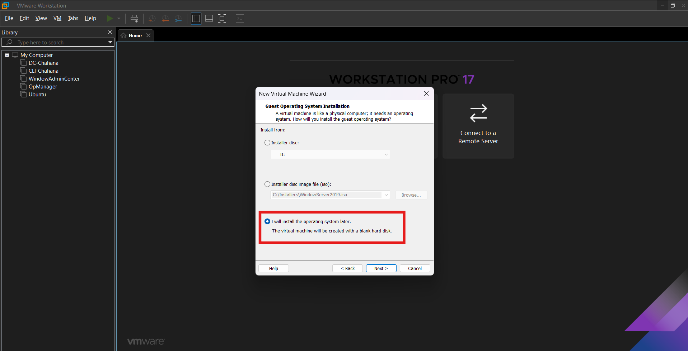
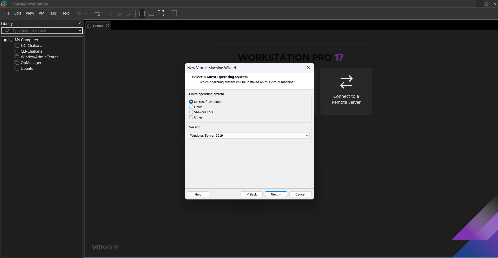
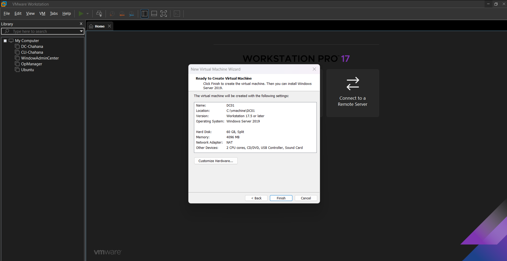
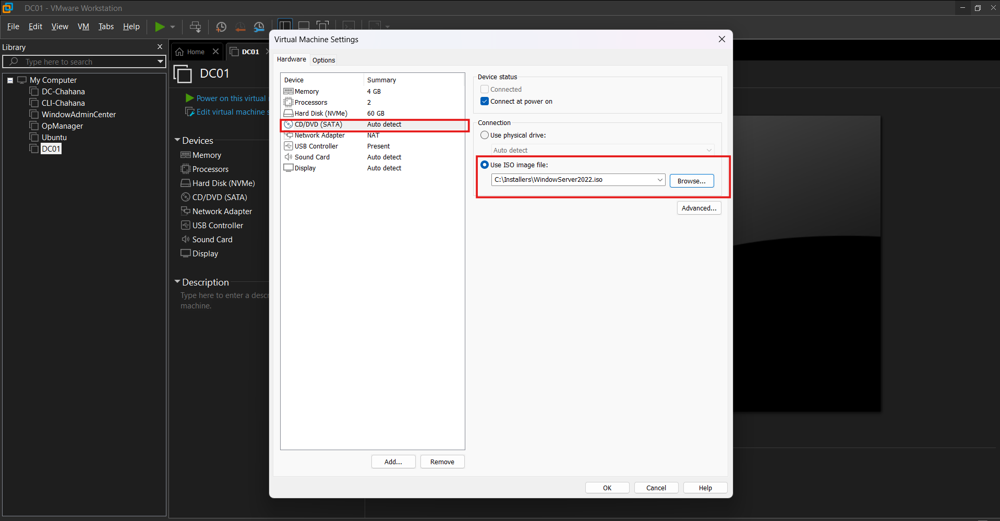
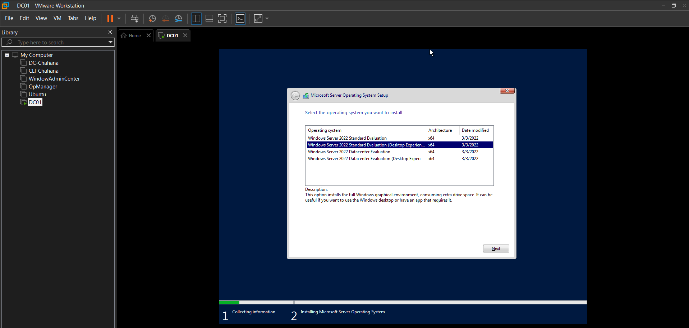
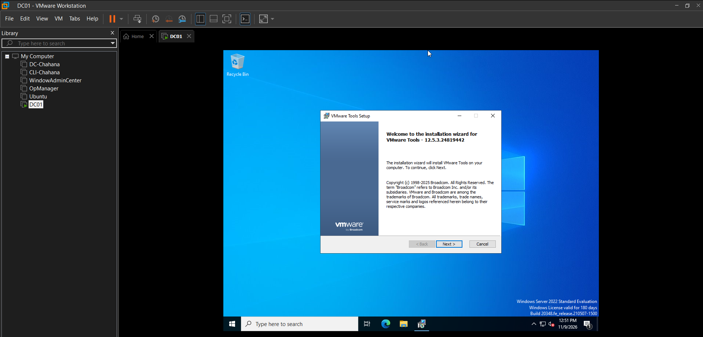

## Module 1: Server Preparation
**What I did:** Set the time zone to Mountain Time, renamed the server to DC01, and assigned a static IP address.

**Why:** A domain controller needs a fixed name and IP address. Changing them after installing Active Directory causes problems.

**Settings:** IP 192.168.205.10, mask 255.255.255.0, gateway 192.168.205.2, DNS 192.168.205.10 (itself) and 8.8.8.8.

**Result:** Ping tests to the server and to 8.8.8.8 succeeded with 0% loss. I took a snapshot as a restore point.

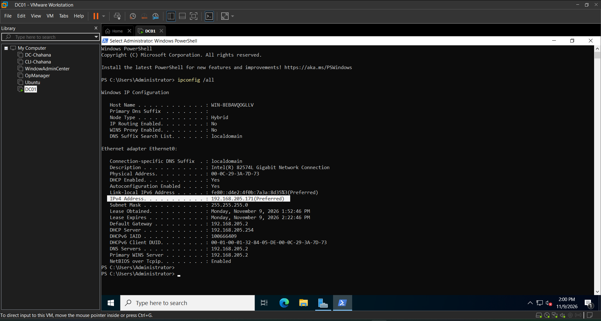
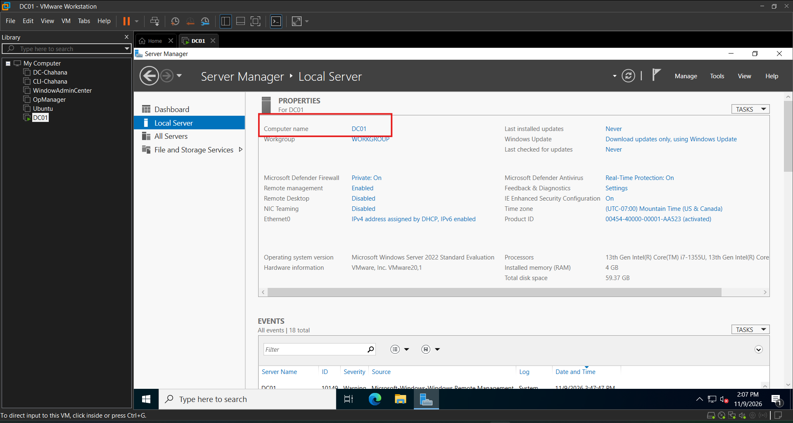
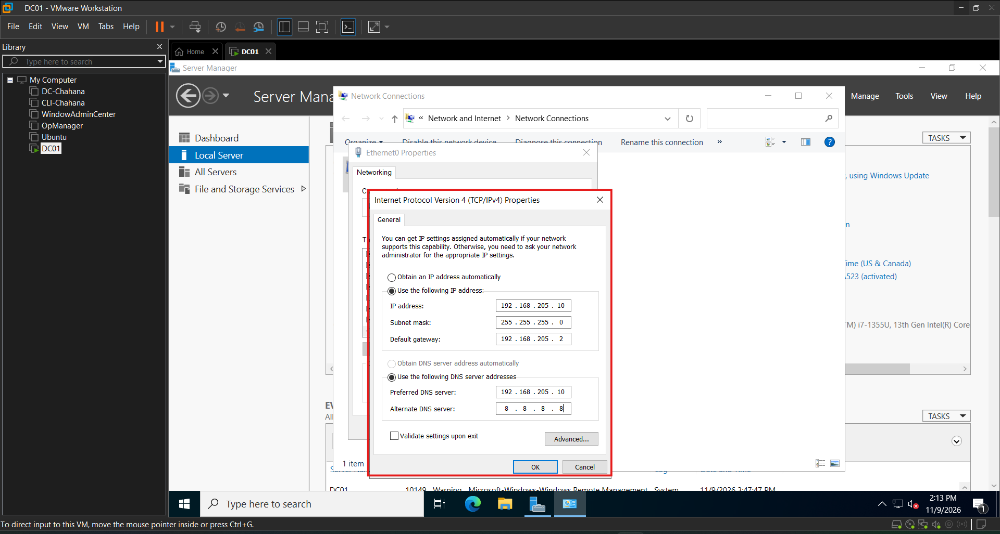
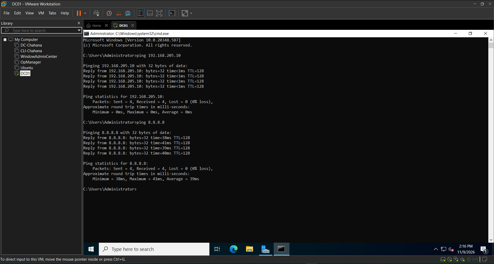
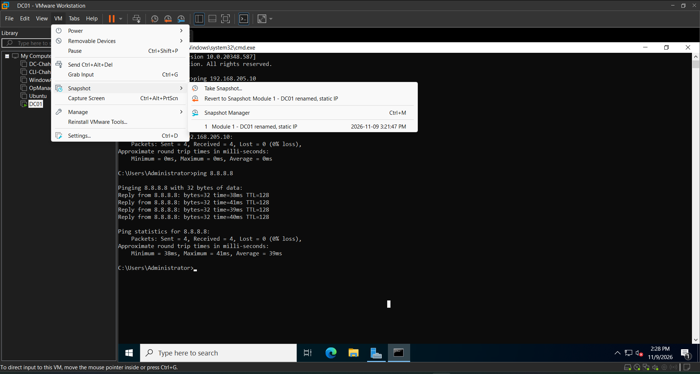

## Module 2: Active Directory
**What I did:** Installed the Active Directory Domain Services role and promoted DC01 to the first domain controller of a new forest, lab.local.

**Why:** Active Directory stores the users, computers, and permissions that a help desk manages every day.

**Settings:** Forest and domain functional level Windows Server 2016, with DNS server and Global Catalog enabled.

**Result:** I signed in as LAB\Administrator, and Active Directory Users and Computers shows lab.local with DC01 under Domain Controllers.

**Note:** The DNS delegation warning during promotion is expected for the first domain controller in a new forest. The DNS forwarder 8.8.8.8 was added automatically, so DC01 answers lab.local itself and forwards internet lookups to Google DNS.

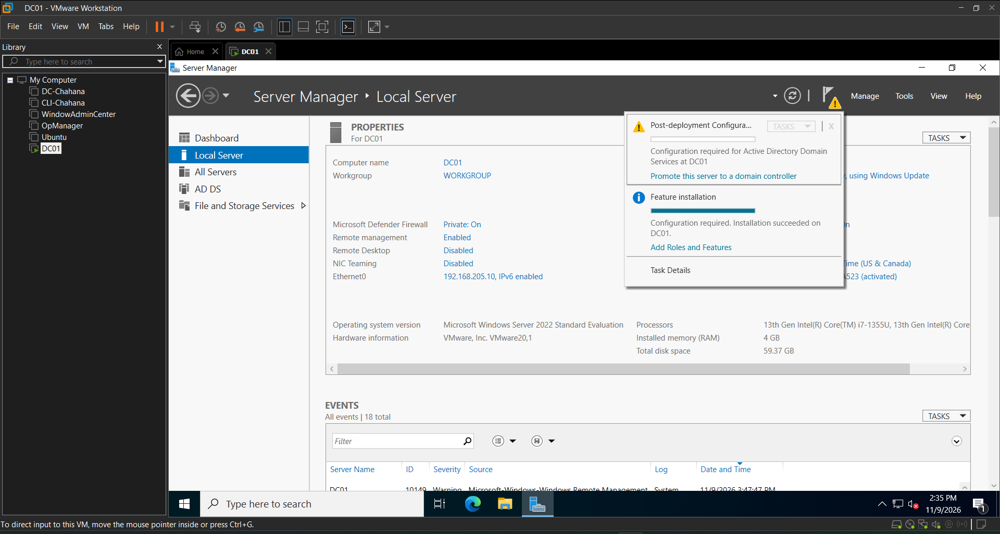
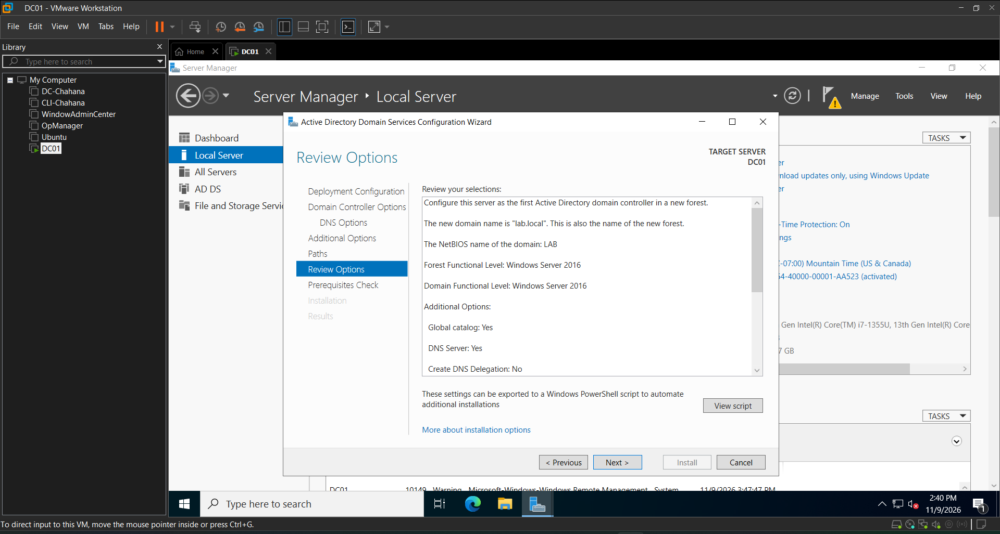
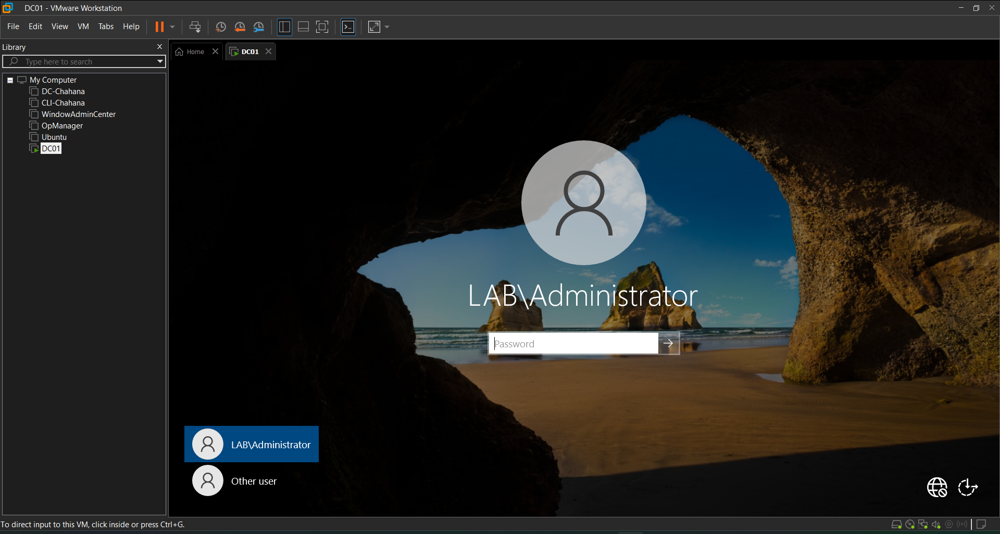
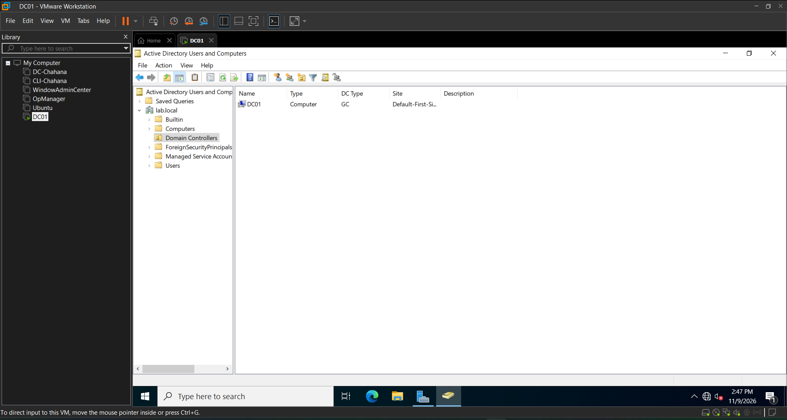
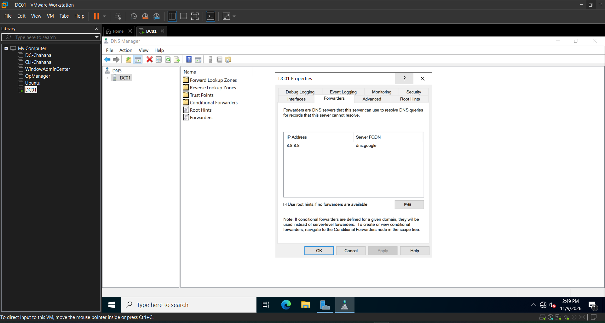
