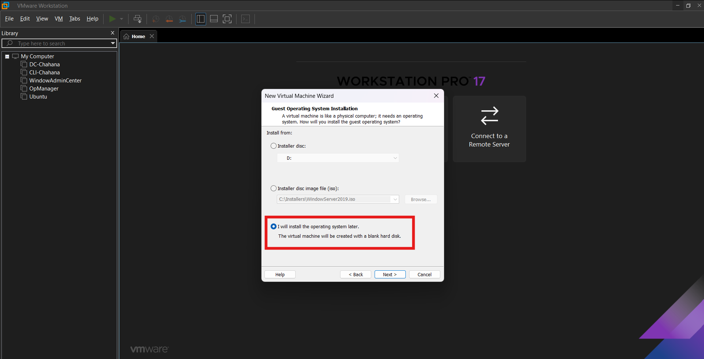
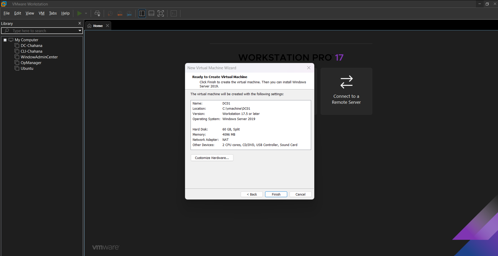
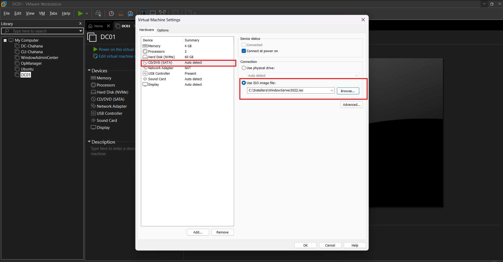
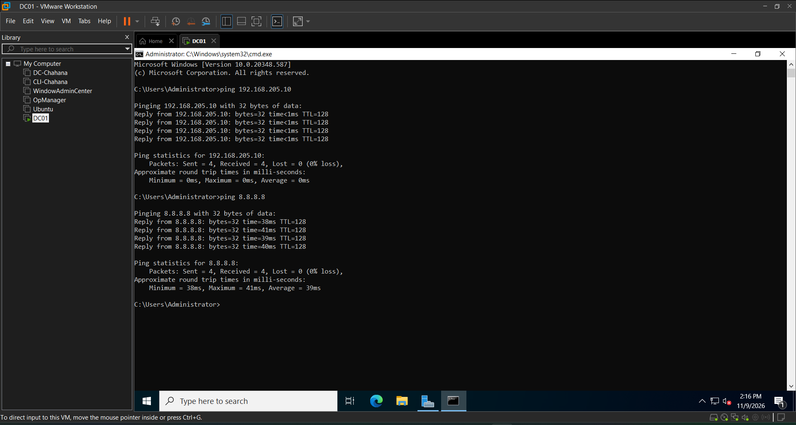
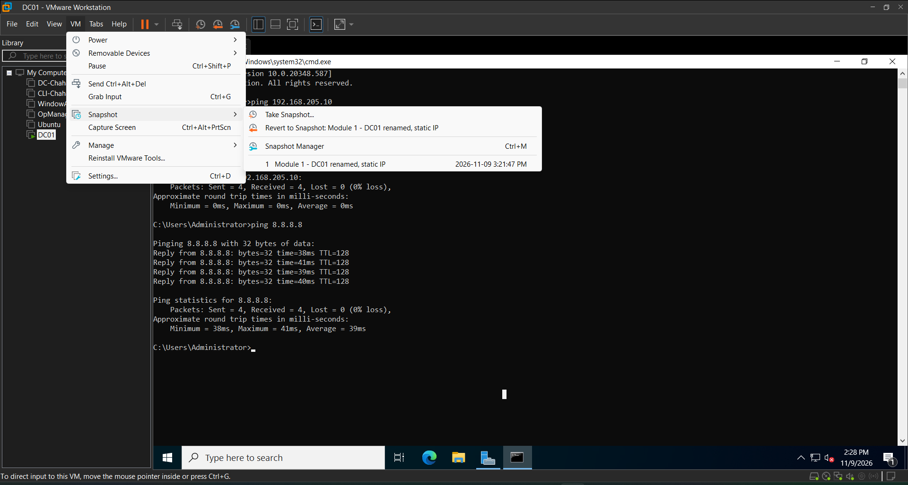
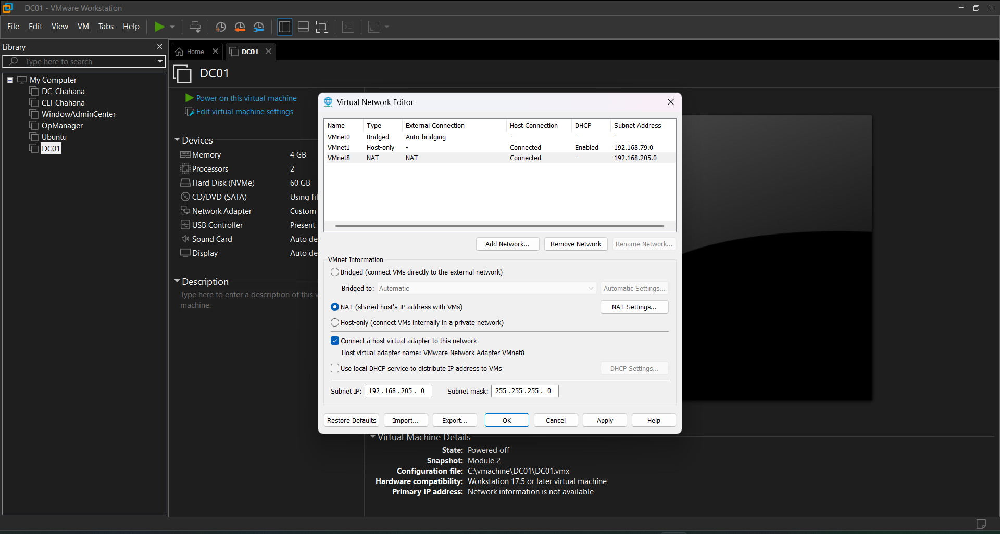
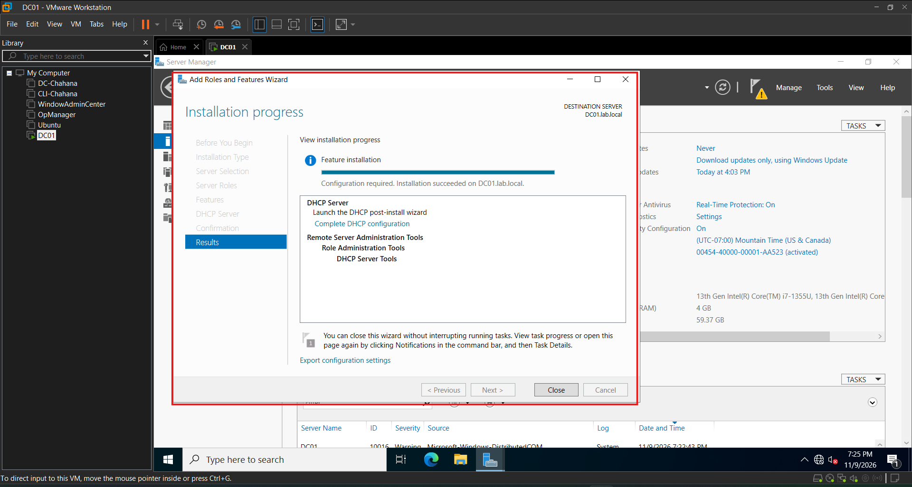
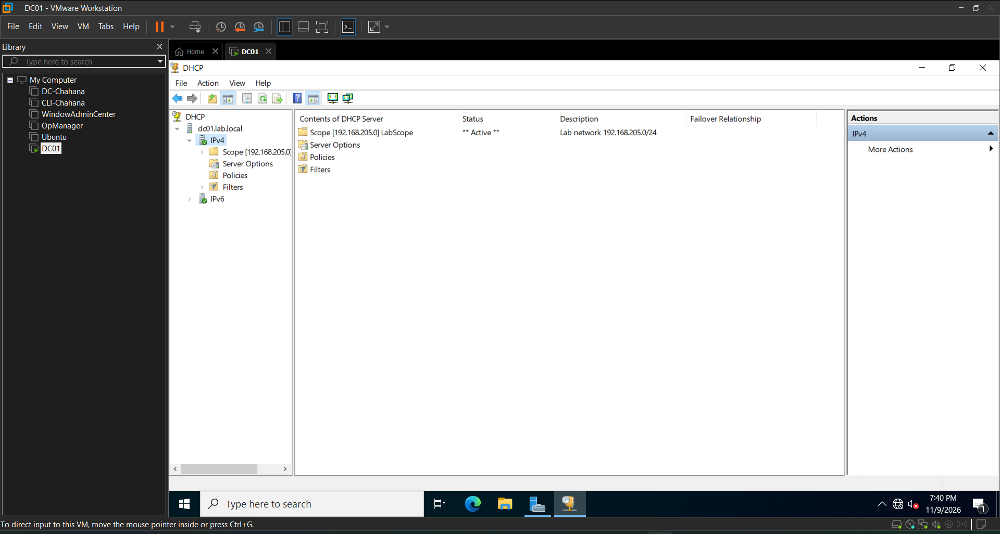
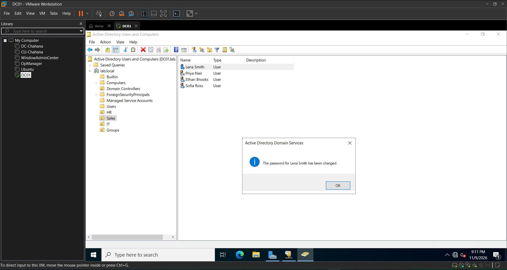
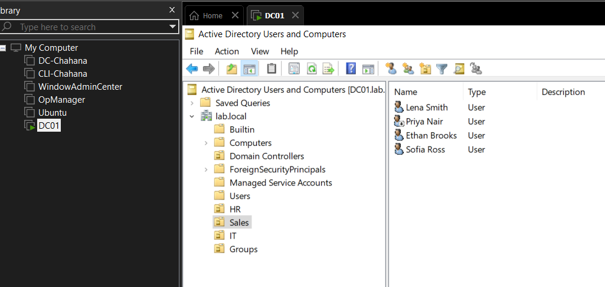

# Help Desk Home Lab: Setup Walkthrough

A virtual IT environment built in VMware Workstation to practice help desk work.

## Lab Environment
| Item | Value |
|---|---|
| Hypervisor | VMware Workstation |
| Server | DC01, Windows Server 2022 Standard (Desktop Experience) |
| Domain | lab.local (NetBIOS: LAB) |
| Server IP | 192.168.205.10 (static) |

## Module 0: Create the Server VM
**What I did:** Created a Window Server 2022 virtual machine in VMware Workstation using a custom configuration and manual attachment of the installation image.

**Why:** I initially ran into issues getting the virtual machine to boot correctly. Using a custom setup gave me more control over the VM configuration and made it easier to troubleshoot the installation process.

**Settings:** 
  - 2 CPU cores
  - 4 GB RAM
  - 60 GB virtual disk
  - NAT network
  - BIOS firmware
    
**Result:** The VM booted successfully from the Window Server 2022 ISO and displayed the available installation editions, confirming that installation media was working correctly. I installed Window Server 2022 Standard (Desktop Experience) and then installed VMware Tools to improve performance and integration with the host system.

**What I learned:**
  - Creating a VM with a custom configuration provides flexibility when troubleshooting installation issues.
  - VMware Tools improves usability by enabling features such as better display support, mouse integration, and improve VM performace.
    

## Module 1: Server Preparation
**What I did:** Configured the server's initial settings by setting the time zone, renaming the computer to DC01, and assigning a static IP address.

**Why:** A domain controller should have a permanent hostname and IP address so clients can reliably locate services such as Active Directory and DNS. Making these changes before deploying Active Directory helps avoid future configuration issues.

**Settings:** 
IP Address: 192.168.205.10
Subnet mask: 255.255.255.0 
Gateway: 192.168.205.2 
DNS: 192.168.205.10 and Alternate DNS: 8.8.8.8.

**Result:** Verified the network configuration by successfully pinging both the server and an external address (8.8.8.8). After confirming connectivity was working as expected, I created a VMware snapshot to use as a recovery point before moving on to the next stage of the lab.

**What I learner:**
  - Assigning a static IP address before installing Active Directory helps ensure DNS and domain services remain consistent..
  - Taking snapshots after major milestones provides an easy recovery option if a future configuration change causes problems.
    

## Module 2: Active Directory
**What I did:** Installed the Active Directory Domain Services role (AD DS) and promoted DC01 to the first domain controller in the new forest called lab.local.

**Why:** Active Directory is the service that stores and manages user accounts, computers, groups, and permissions. Since many Help Desk tasks involve managing user accounts and access, setting up Active Directory was a key part of building the lab.

**Settings:**
  - Forest: lab.local
  - Forest functional level: Window Server 2016
  - Domain functional level: Window Server 2016
  - DNS Server: enabled
  - Global Catalog: enabled

**Result:** After promotion and reboot, I signed in as LAB\Administrator. I then open Active Directory Users and Computers and confirmed that the lab.local domain had been created successfully with DC01 listed int the Domain Controllers organizational unit.

**Note:** While promoting the server, I received a DNS delegation warning. After some research, I learned that this is normal when creating the first domain controller in a new forest. Once the setup finished, DC01 successfully hosted the lab.local DNS zone and was able to forward external DNS requests through the configured DNS forwarder.

## Module 3: DHCP

**What I did:** I configured DC01 to provide IP addresses and network settings to devices on the lab network automatically, eliminating the need to configure each client manually.

**First, a small thing I had to do:** VMware has its own built-in DHCP service, and having two DHCP servers on the same network can cause conflicts. To avoid this, I disabled VMware's DHCP service on the VMnet8 network so DC01 would be the only device assigning addresses.

**Setup:** I installed the DHCP Server role, completed the post-installation configuration, and authorized the server in Active Directory using the Commit step. Without authorization, the DHCP server would not issue leases. I then created a scope called LabScope: 
- Address range: 192.168.205.100 to 192.168.205.200
- Gateway (router): 192.168.205.2
- DNS server: 192.168.205.10 (DC01)
- Domain name: lab.local

I intentionally kept DC01's address (192.168.205.10) outside the DHCP scope so it could never be assigned to a client by mistake.

**What I learned:** DHCP provides more than just an IP address. It also supplies clients with their gateway, DNS server, and domain information. During this lab, I learned how important DHCP is to network connectivity and how many user connectivity issues can often be traced back to DHCP-related problems.

## Module 4: Users, Groups and Departments

**What I did:** I built a small fake company inside Active Directory. It has four OUs (think of them as folders): HR, Sales, IT and Groups. I made 9 users and spread them across the departments:
- HR: Noah Gold, Omar Silva
- Sales: Lena Smith, Priya Nair, Ethan Brooks, Sofia Ross
- IT: Hana Sato, Zara Ali, Marcus Rie

Then I created three security groups: HR-Staff, Sales-Staff and IT-Staff. A group lets you give access to a whole department at once instead of setting it up person by person.

**Two mistakes I made and fixed:**
1. I misspelled one group as "Sales-Saff". I caught it in the list and renamed it.
2. I mixed up the members. The Sales group had the IT people in it, and the IT group had the Sales people. The folder column in the members list showed me something was wrong, because it didn't match the group name. I fixed it by swapping the group names, and then checked each group again.

**Daily help desk tasks I practiced:**
- **Reset a password:** I reset Lena Smith's password and set it so she has to change it at her next login.
- **Disable an account:** I disabled Priya Nair's account (a small badge appears on her icon), then enabled it again.
- **Move a user:** I moved Lena Smith from Sales to HR and moved her back again to her Sales Group.
  
**What I learned:** Moving a user to another OU doesn't change which groups they belong to. The OU is where the account lives, and groups control access, so in a real transfer you'd also change the groups.

I took a snapshot after each module so I can restore the lab if something breaks.
