# Help Desk Home Lab: Setup Walkthrough

A virtual IT environment built in VMware Workstation to practice help desk work.

## Lab Environment
| Item | Value |
|---|---|
| Hypervisor | VMware Workstation |
| Server | DC01, Windows Server 2022 Standard (Desktop Experience) |
| Domain | lab.local (NetBIOS: LAB) |
| Server IP | 192.168.205.10 (static) |

## Module 0: Create the Server VM
**What I did:** Created a Window Server 2022 virtual machine in VMware Workstation using a custom configuration and manual attachment of the installation image.

**Why:** I initially ran into issues getting the virtual machine to boot correctly. Using a custom setup gave me more control over the VM configuration and made it easier to troubleshoot the installation process.

**Settings:** 
  - 2 CPU cores
  - 4 GB RAM
  - 60 GB virtual disk
  - NAT network
  - BIOS firmware
    
**Result:** The VM booted successfully from the Window Server 2022 ISO and displayed the available installation editions, confirming that installation media was working correctly. I installed Window Server 2022 Standard (Desktop Experience) and then installed VMware Tools to improve performance and integration with the host system.

**What I learned:**
  - Creating a VM with a custom configuration provides flexibility when troubleshooting installation issues.
  - VMware Tools improves usability by enabling features such as better display support, mouse integration, and improve VM performace.
    

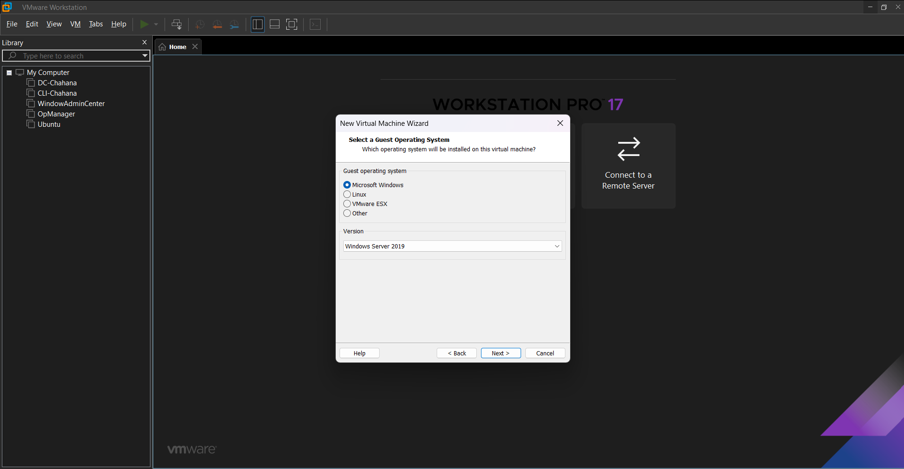

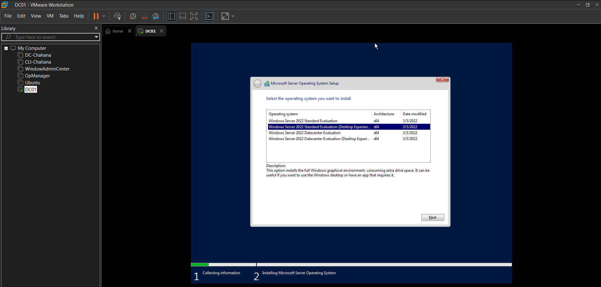
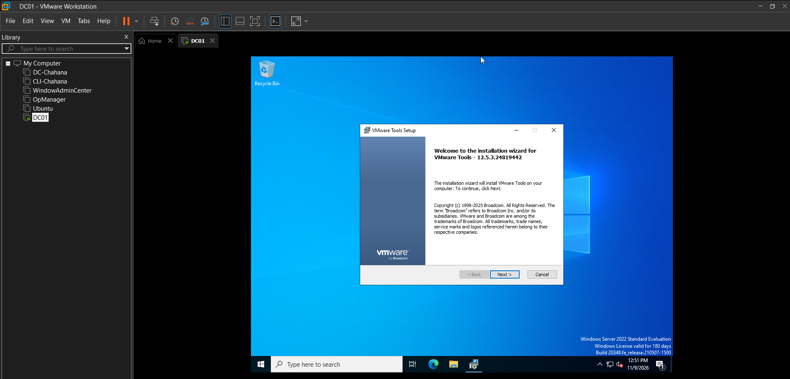

## Module 1: Server Preparation
**What I did:** Configured the server's initial settings by setting the time zone, renaming the computer to DC01, and assigning a static IP address.

**Why:** A domain controller should have a permanent hostname and IP address so clients can reliably locate services such as Active Directory and DNS. Making these changes before deploying Active Directory helps avoid future configuration issues.

**Settings:** 
IP Address: 192.168.205.10
Subnet mask: 255.255.255.0 
Gateway: 192.168.205.2 
DNS: 192.168.205.10 and Alternate DNS: 8.8.8.8.

**Result:** Verified the network configuration by successfully pinging both the server and an external address (8.8.8.8). After confirming connectivity was working as expected, I created a VMware snapshot to use as a recovery point before moving on to the next stage of the lab.

**What I learner:**
  - Assigning a static IP address before installing Active Directory helps ensure DNS and domain services remain consistent..
  - Taking snapshots after major milestones provides an easy recovery option if a future configuration change causes problems.
    
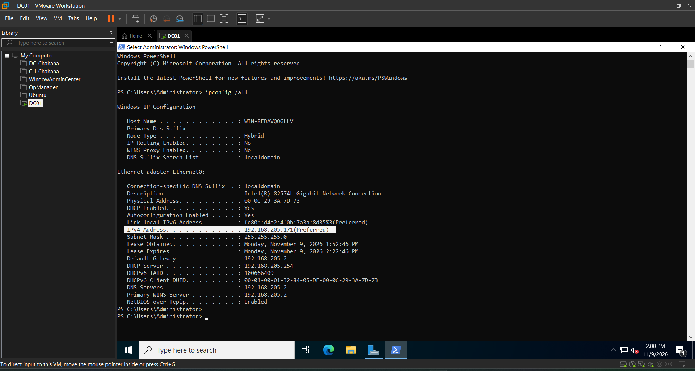
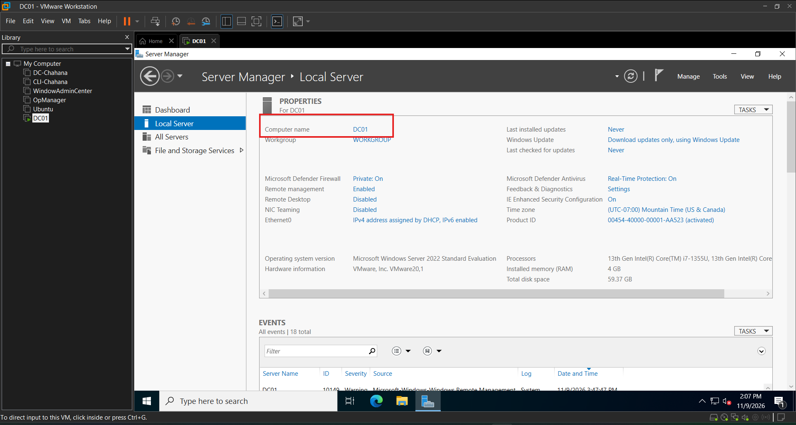
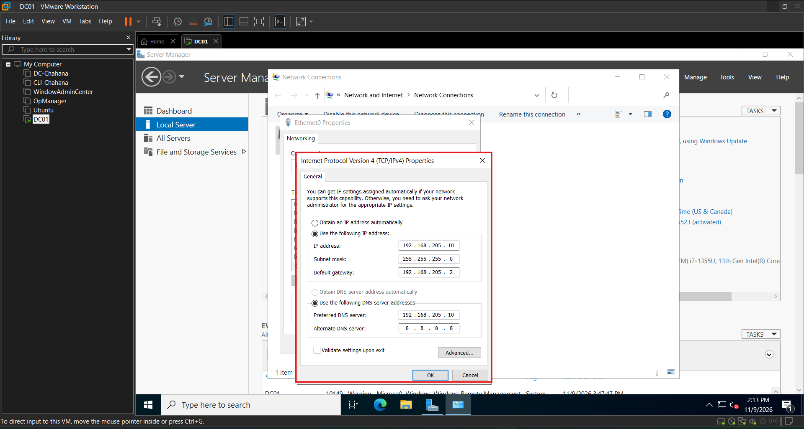

## Module 2: Active Directory
**What I did:** Installed the Active Directory Domain Services role (AD DS) and promoted DC01 to the first domain controller in the new forest called lab.local.

**Why:** Active Directory is the service that stores and manages user accounts, computers, groups, and permissions. Since many Help Desk tasks involve managing user accounts and access, setting up Active Directory was a key part of building the lab.

**Settings:**
  - Forest: lab.local
  - Forest functional level: Window Server 2016
  - Domain functional level: Window Server 2016
  - DNS Server: enabled
  - Global Catalog: enabled

**Result:** After promotion and reboot, I signed in as LAB\Administrator. I then open Active Directory Users and Computers and confirmed that the lab.local domain had been created successfully with DC01 listed int the Domain Controllers organizational unit.

**Note:** While promoting the server, I received a DNS delegation warning. After some research, I learned that this is normal when creating the first domain controller in a new forest. Once the setup finished, DC01 successfully hosted the lab.local DNS zone and was able to forward external DNS requests through the configured DNS forwarder.

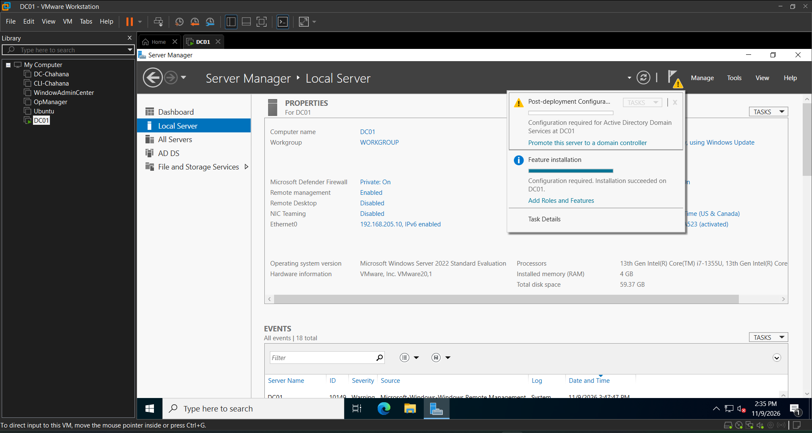
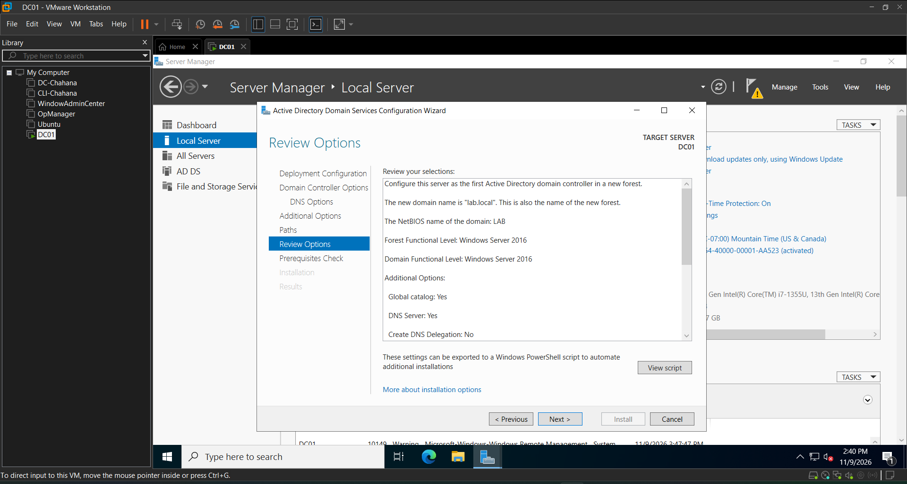
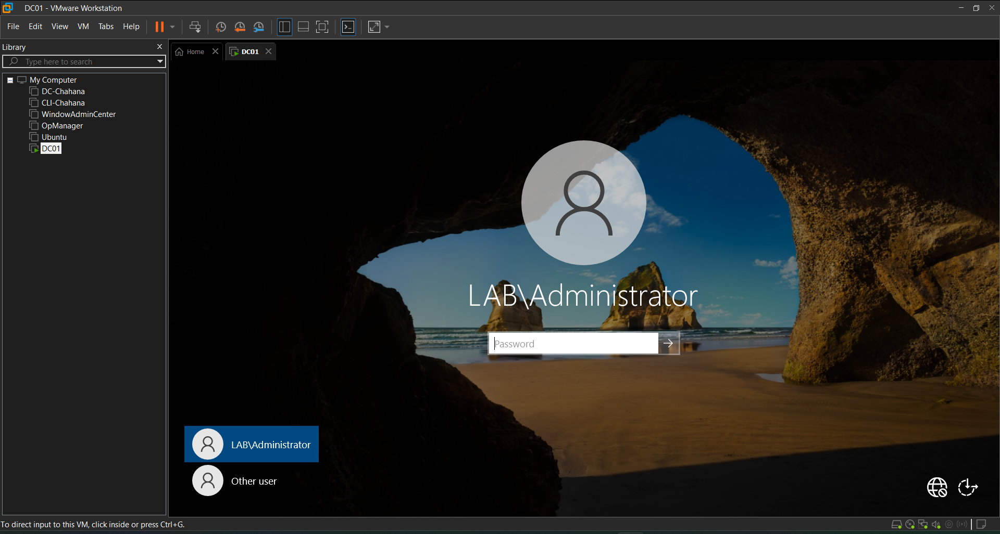
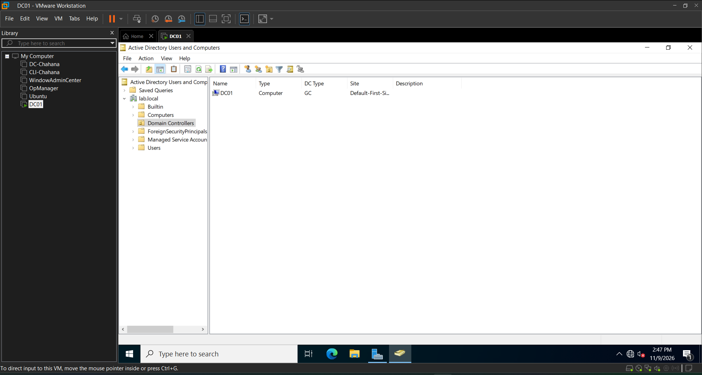
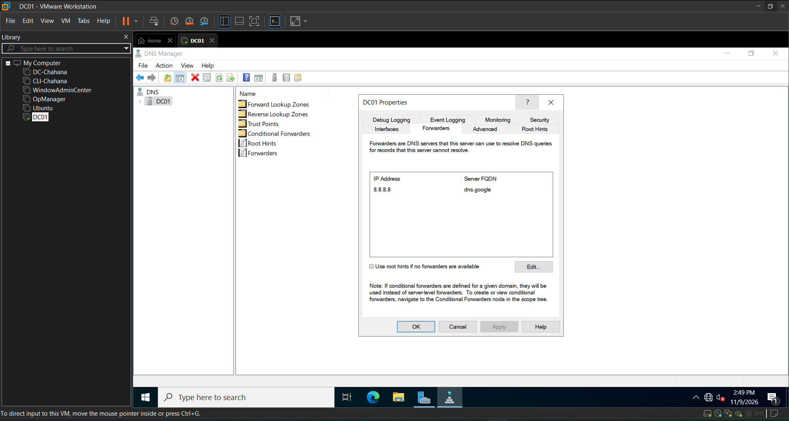

## Module 3: DHCP

**What I did:** I configured DC01 to provide IP addresses and network settings to devices on the lab network automatically, eliminating the need to configure each client manually.

**First, a small thing I had to do:** VMware has its own built-in DHCP service, and having two DHCP servers on the same network can cause conflicts. To avoid this, I disabled VMware's DHCP service on the VMnet8 network so DC01 would be the only device assigning addresses.

**Setup:** I installed the DHCP Server role, completed the post-installation configuration, and authorized the server in Active Directory using the Commit step. Without authorization, the DHCP server would not issue leases. I then created a scope called LabScope: 
- Address range: 192.168.205.100 to 192.168.205.200
- Gateway (router): 192.168.205.2
- DNS server: 192.168.205.10 (DC01)
- Domain name: lab.local

I intentionally kept DC01's address (192.168.205.10) outside the DHCP scope so it could never be assigned to a client by mistake.

**What I learned:** DHCP provides more than just an IP address. It also supplies clients with their gateway, DNS server, and domain information. During this lab, I learned how important DHCP is to network connectivity and how many user connectivity issues can often be traced back to DHCP-related problems.

## Module 4: Users, Groups and Departments

**What I did:** I created four Organizational Units (OUs) in Active Directory: HR, Sales, IT, and Groups. I then created nine users and organized them into their respective departments:
- HR: Noah Gold, Omar Silva
- Sales: Lena Smith, Priya Nair, Ethan Brooks, Sofia Ross
- IT: Hana Sato, Zara Ali, Marcus Rie

I also created three security groups: HR-Staff, Sales-Staff, and IT-Staff. Security groups make it possible to assign permissions to an entire department instead of managing access for each user individually.

**Two mistakes I made and fixed:**
1. I accidentally created the Sales-Staff group as Sales-Saff. After reviewing the group list, I noticed the typo and corrected it.
2. While reviewing memberships, I realized the Sales users had been assigned to the IT group and the IT users had been assigned to the Sales group. The OU paths shown in the membership list helped me identify the issue, and I corrected the assignments before continuing.

**Help Desk tasks I practiced:**
- **Reset a password:** I reset Lena Smith's password and set it so she has to change it at her next logon.
- **Disable an account:** Disabled Priya Nair's account and then re-enabled it.
- **Move a user:** Moved Lena Smith from the Sales OU to the HR OU and later returned the account to its original location.
  
**What I learned:** Moving a user to a different OU does not automatically affect group memberships. OUs are primarily used for organization and policy management, while security groups are commonly used for permissions and access control. In a real user transfer, both should be reviewed.

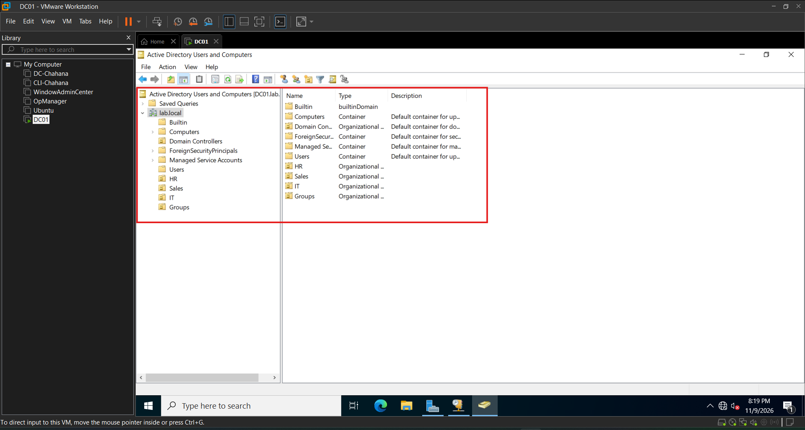

I took a snapshot after each module so I can restore the lab if something breaks.

## Module 5: Windows Client
**What I did:** Created a Windows client workstation named CLIENT01, connected it to the lab network, and joined it to the lab.local Active Directory domain.

**Why:** Most Help Desk support is performed on client devices rather than servers. Adding a workstation to the environment allowed me to test domain connectivity, user authentication, and Active Directory management from an end-user perspective.

**Setup:**
  - Computer Name: CLIENT01
  - Network: VMnet8 (NAT)
  - IP Assignment: DHCP
  - Domain: lab.local

**Verification:**
  - Verified communication with the domain controller.
  - Successfully joined CLIENT01 to the lab.local domain.
  - Signed in using the Active Directory user account lsmith.
  - Completed the required password change at first logon.

**Result:** CLIENT01 successfully joined the domain and authenticated against Active Directory. During the first login, the account was required to change its password, confirming that the password policy configured earlier in the lab was being enforced correctly.

**What I learned:** A successful domain join depends on several services working together. The client must receive valid network settings, locate the domain controller through DNS, and authenticate through Active Directory. This module helped me understand how workstations become part of a domain environment and how user authentication is managed centrally.

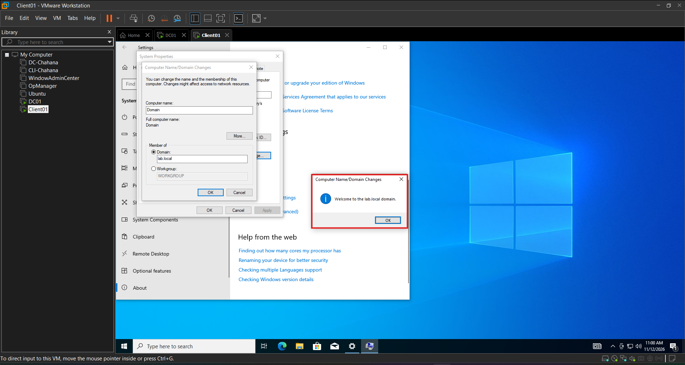
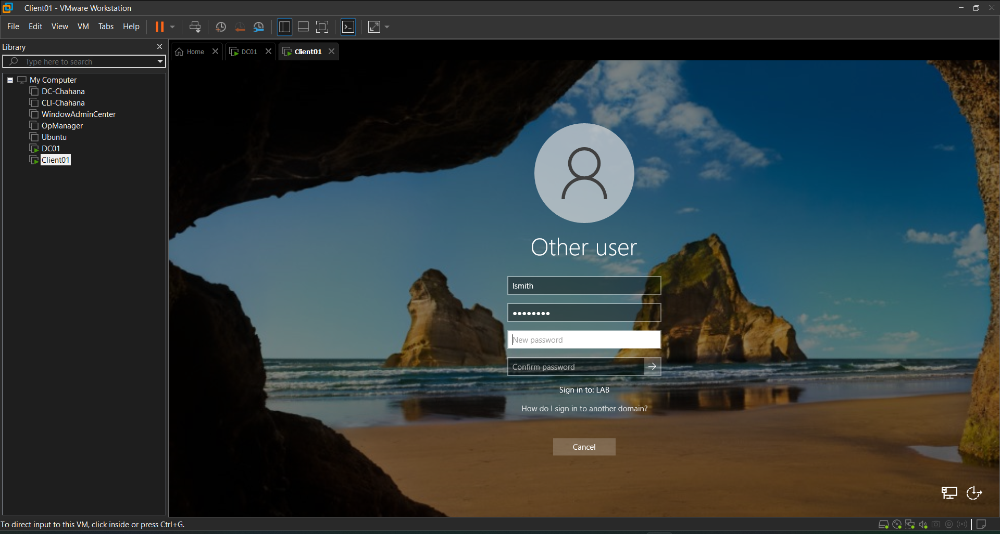

## Module 6: Shared Folders and Permissions
**What I did:** I created shared folder on DC01 for HR, Sales and IT. Then I configured access using the Active Directory security groups created earlier in the lab.

**Why:** Shared folders are commonly used in business environments to store department-specific files. Using security groups to control access makes permission management easier and more scalable than assigning permissions to individual users.

**Setup:**
Created the following folders:
  - C:\Shares\HR
  -  C:\Shares\Sales
  -   C:\Shares\IT
Shared each folder on the network.
Assigned permission to the corresponding departments groups:
  - HR = HR-Staff
  - Sales = Sales-Staff
  - IT = IT-Staff

**Verification:**
- Logged into Client01 as lsmith (Sales department staff)
- Successfully accessed the Sales shared folder.

- Attempted to access the HR shared folder, access was denied because the account was not a member of the HR-Staff group.

**Result:** Group-based access control worked as expected. Sales users were able to access Sales resources while being prevented from accessing files belonging to other departments.

**What I learned:** Shared folder permissions and Active Directory security groups work together to control access to resources. This approach is easier to manage than assigning permissions directly to individual users and reflects how access is commonly managed in business environments.

